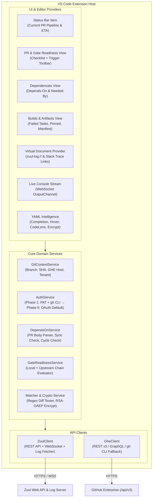
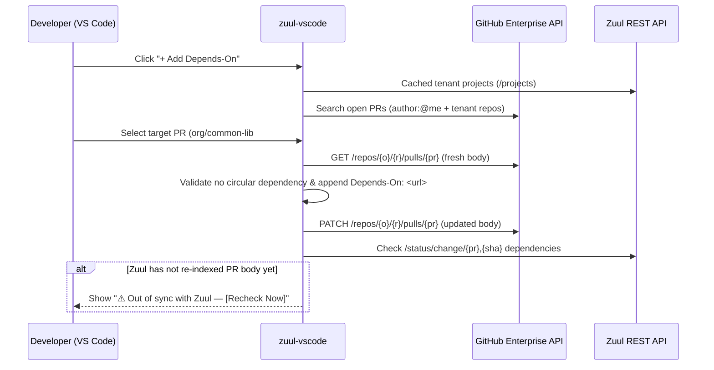
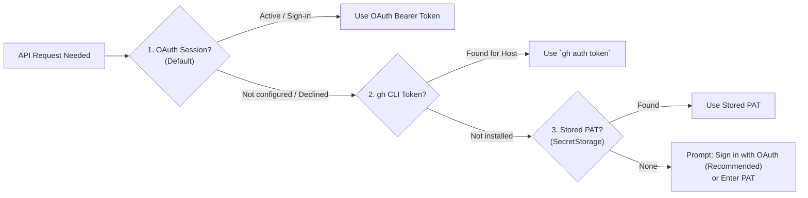

# Zuul CI for VS Code (`zuul-vscode`) — Implementation Plan

A VS Code extension built for teams running **Zuul CI** with **GitHub Enterprise (GHE)**. It unifies PR dependency management (`Depends-On`), Gate readiness diagnostics, custom comment triggers, build artifact/log inspection, and `.zuul.yaml` authoring intelligence directly inside VS Code.

---

## 1. System Architecture



---

## 2. Target Workspace Structure (`zuul-vscode`)

```text
zuul-vscode/
├── package.json                  # Extension manifest, views, commands, settings, schemas
├── tsconfig.json
├── esbuild.mjs                   # Fast bundler for extension host
├── vitest.config.ts              # Unit & integration test runner
├── schemas/
│   └── zuul-schema.json          # Static base JSON schema for .zuul.yaml / zuul.d/*.yaml
├── resources/
│   └── icons/                    # Activity bar & status icons
├── src/
│   ├── extension.ts              # Activation, command registration, lifecycle wiring
│   ├── config/
│   │   └── settings.ts           # Typed workspace/user configuration reader
│   ├── auth/
│   │   ├── authService.ts        # Unified auth manager (Strategy pattern)
│   │   ├── patAuthProvider.ts    # Phase 1: VS Code SecretStorage PAT provider
│   │   ├── ghCliAuthProvider.ts  # Phase 1: `gh auth token --hostname` provider
│   │   ├── gheOAuthProvider.ts   # Phase 6: GHE OAuth Device / URI Handler + VS Code Auth
│   │   └── zuulAuthProvider.ts   # Phase 6: Optional Zuul OIDC / Bearer token provider
│   ├── git/
│   │   └── gitContext.ts         # Detects remote GHE host, org/repo, branch, HEAD SHA
│   ├── clients/
│   │   ├── zuulClient.ts         # Typed client for /api/tenant/{tenant}/* & log server
│   │   └── gheClient.ts          # Typed client for GHE PRs, reviews, labels, comments, search
│   ├── services/
│   │   ├── dependsOnParser.ts    # Lossless parsing/editing of `Depends-On:` in PR body
│   │   ├── dependsOnService.ts   # Sync check (GHE vs Zuul), cycle check, tenant PR search
│   │   ├── gateReadiness.ts      # Evaluates PR + upstream chain against gate requirements
│   │   ├── triggerService.ts     # Posts trigger comments & fast-polls until enqueue
│   │   ├── artifactService.ts    # Parses job-output.json(.gz) & zuul-manifest.json
│   │   ├── logStreamService.ts   # Streams /console-stream WebSocket to OutputChannel
│   │   ├── secretEncryptor.ts    # Pure Node crypto RSA-OAEP PKCS#1 encryption
│   │   └── fileMatcher.ts        # Evaluates job `files` / `irrelevant-files` on git diff
│   ├── views/
│   │   ├── statusBar.ts          # Live pipeline progress & ETA in status bar
│   │   ├── prGateTreeView.ts     # Gate readiness checklist & quick trigger actions
│   │   ├── dependsOnTreeView.ts  # Upstream (Depends-On) & Downstream (Needed-By) tree
│   │   ├── buildsTreeView.ts     # Pipeline jobs, failed Ansible tasks, pinned & manifest logs
│   │   └── logDocumentProvider.ts# `zuul-log://` reader + workspace stack trace LinkProvider
│   └── language/
│       ├── completionProvider.ts # Autocomplete jobs, nodesets, project-templates, roles
│       ├── hoverProvider.ts      # Hover docs for parent jobs, nodesets, variables
│       ├── definitionProvider.ts # Jump to playbook files, roles, and local job definitions
│       └── effectiveJobLens.ts   # CodeLens preview of flattened job inheritance
└── test/
    ├── dependsOnParser.test.ts
    ├── gateReadiness.test.ts
    ├── secretEncryptor.test.ts
    ├── fileMatcher.test.ts
    └── artifactService.test.ts
```

---

## 3. Phased Implementation Plan

### Phase 1: Foundation, Git Context & PAT / `gh` CLI Authentication
**Goal**: Establish the extension skeleton, auto-detect the repository's GHE and Zuul context, and authenticate reliably using a Personal Access Token (PAT) or local `gh` CLI session.

1. **Project Scaffolding**:
   * Initialize `package.json` with Activity Bar container (`zuul-explorer`), 3 sidebar views (`zuul.gateReadiness`, `zuul.dependencies`, `zuul.builds`), activation events (`workspaceContains:.zuul.yaml`, `workspaceContains:zuul.d`, `onStartupFinished`), and extension settings.
2. **Git & Workspace Context (`GitContextService`)**:
   * Use VS Code's built-in `vscode.git` extension API to watch the active repository, current branch, `HEAD` commit SHA, and remote URL (`git@<ghe-host>:<org>/<repo>.git` or `https://<ghe-host>/<org>/<repo>.git`).
   * Auto-resolve the Zuul tenant name from `.vscode/settings.json` (`zuul.url`, `zuul.tenant`) or by querying `/api/tenants` and matching `/api/tenant/{tenant}/projects` against `<org>/<repo>`.
3. **Authentication v1 (`AuthService`)**:
   * **Primary (Phase 1)**: **PAT via `SecretStorage`** — Command `Zuul: Set GitHub Enterprise PAT` prompts the user for a token, validates it against `GET https://<ghe-host>/api/v3/user`, and stores it keyed by `<ghe-host>` in `context.secrets`.
   * **Zero-Config Fallback**: **`gh` CLI Provider** — Executes `gh auth token --hostname <ghe-host>` if no PAT is stored in `SecretStorage`, inheriting existing CLI authentication.
   * Support custom corporate CA certificates (`NODE_EXTRA_CA_CERTS` / `http.proxySupport`) for internal GHE and Zuul hosts.
4. **Typed API Clients (`GheClient` & `ZuulClient`)**:
   * `GheClient`: Fetch open PR for current branch, read/update PR `body`, list reviews, list issue/PR labels, query commit statuses (`/commits/{sha}/status`), check runs (`/commits/{sha}/check-runs`), and branch protection / GraphQL `statusCheckRollup` (`isRequired`), post issue comments, and search open PRs across the organization/tenant.
   * `ZuulClient`: Fetch `/status/change/{pr},{sha}`, `/builds`, `/jobs`, `/nodesets`, `/projects`, `/project-templates`, and `/key/{project}.pub`.

---

### Phase 2: Live Build Monitoring, Sidebar & Custom Trigger Comments
**Goal**: Show real-time Zuul status for the active PR and allow firing custom trigger comments (`recheck`, `gate`, etc.) with immediate visual feedback.

1. **Adaptive Polling Engine**:
   * Poll `/api/tenant/{tenant}/status/change/{pr},{sha}` every 15s when a buildset is active in `check`/`gate`, backing off to 60s when idle (and falling back to `/api/tenant/{tenant}/builds?project=...&change={pr}` once the change leaves the active status queue).
2. **Status Bar Item**:
   * Display current pipeline state, e.g. `$(sync~spin) Zuul check: 3/5 (ETA 4m)` or `$(check) Zuul check: PASSED` or `$(error) Zuul check: 1 failed`.
3. **Custom Trigger Comments (`TriggerService`)**:
   * Read team-configurable triggers from `.vscode/settings.json`:
     ```json
     "zuul.triggerComments": [
       { "label": "Recheck", "comment": "recheck", "icon": "refresh" },
       { "label": "Gate", "comment": "gate", "icon": "rocket" },
       { "label": "Experimental", "comment": "check-experimental", "icon": "beaker" }
     ]
     ```
   * Also provide `Zuul: Post Custom Trigger Comment...` for ad-hoc comments or job-specific rechecks.
   * **Post & Watch Loop**: After posting the comment to GHE (`POST /api/v3/repos/{owner}/{repo}/issues/{pr}/comments`), switch the UI state to *"Waiting for Zuul to enqueue..."* and poll every 3 seconds (up to 45s) until the new buildset appears in Zuul.

---

### Phase 3: PR `Depends-On` Manager & Gate Readiness Inspector
**Goal**: Manage `Depends-On` headers in GHE PR descriptions directly from VS Code and diagnose why a PR hasn't entered `gate`.



1. **Lossless PR Description Parser (`DependsOnParser`)**:
   * Extract all `Depends-On: <url | org/repo#num>` lines (case-insensitive) from the GHE PR `body`.
   * Append new `Depends-On: https://<ghe-host>/<org>/<repo>/pull/<num>` cleanly at the bottom of the description without altering existing markdown, checklists, or templates.
   * Remove specific `Depends-On:` entries cleanly when clicking the inline delete action (`🗑️`).
2. **Dependencies TreeView (`DependsOnTreeProvider`)**:
   * **Upstream (`Depends On`)**: Lists every dependency parsed from the PR body, enriched with its live GHE state (`Open`, `Merged`, `Closed`, review status) and live Zuul pipeline status (`check`/`gate` result).
   * **Downstream (`Needed By`)**: Reads `needed_by` from Zuul's `/status/change/{pr},{sha}` response so you see which downstream PRs depend on your change.
   * **Out-of-Sync Detector**: Compares the PR body's `Depends-On` list against Zuul's active `dependencies` field. If you added/removed a dependency in GHE and Zuul hasn't picked it up yet, displays a warning item with a one-click **"Sync via Recheck"** button.
3. **Interactive `Add Depends-On` QuickPick**:
   * Pre-populates open PRs authored by `@me` across the tenant, open PRs from other repositories currently open in your VS Code workspace, and live search across GHE PRs.
   * Validates that the target repo belongs to the Zuul tenant and checks for circular dependencies before patching the PR body.
4. **"Why Isn't My PR in `gate`?" (`GateReadinessService`)**:
   * Evaluates configurable and auto-detected gate preconditions for both the current PR and every upstream PR in its `Depends-On` chain (even across different repositories with different rules):
     * **Zuul `check` status**: Latest buildset passed on `HEAD` SHA?
     * **Dynamic Per-Repo GitHub Status Contexts & Check Runs**:
       * Queries GHE GraphQL `statusCheckRollup` (using `isRequired(pullRequestId: ...)` to automatically detect which status contexts/check-runs are required by branch protection on that specific repository without needing admin permissions) and falls back to REST `/branches/{base}/protection/required_status_checks` + `/commits/{sha}/status` + `/commits/{sha}/check-runs`.
       * Flags any required status context (e.g., `sonarqube`, `cla/enterprise`, `security-scan`, `<tenant>/check`) that is `pending`, `failure`, `error`, or missing on the PR's `HEAD` commit.
       * Supports optional per-repo overrides via `zuul.gate.requiredStatusChecks` (e.g., `{ "*": ["my-tenant/check"], "org/payment-svc": ["sonar", "pci-check"] }`).
     * **GHE Reviews**: Required count of `APPROVED` reviews met (auto-detected via GraphQL `reviewDecision` / branch protection or `zuul.gate.requiredApprovals`), and zero `CHANGES_REQUESTED` reviews?
     * **GHE PR State**: Not a `Draft`, `mergeable_state` is not `dirty`/`blocked`, required labels present (`zuul.gate.requiredLabels`), blocking labels absent (`zuul.gate.blockingLabels`).
     * **Recursive Upstream `Depends-On` Audit**: Checks every unmerged upstream PR in the `Depends-On` chain against its own repository's status checks and review rules, pinpointing exact upstream blockers (e.g., *"Blocked by upstream `org/api#55`: required status check `sonarqube` is `pending`"*).

---

### Phase 4: Job Artifacts, Failed Task Diagnostics & Live Log Streaming
**Goal**: Eliminate browser context-switching when triaging failed builds or inspecting logs.

1. **Failed Ansible Task Extractor (`job-output.json`)**:
   * When expanding a failed build in the `Pipeline Builds` tree, automatically fetch `<log_url>/job-output.json` (or `.json.gz`).
   * Walk plays -> tasks -> hosts to find any task with `failed: true` or non-zero `rc`, and surface those tasks as top-level children under the failed build (`🔥 Failed Task: <task name> [host]`).
   * Clicking the task opens a virtual document containing the structured task command, `stdout`, `stderr`, and `msg`.
2. **Pinned Artifacts & `zuul-manifest.json` Explorer**:
   * Render explicit build `artifacts` returned by the Zuul Builds API.
   * Promote files matching `.vscode/settings.json` `"zuul.pinnedArtifacts"` (e.g., `["job-output.txt", "controller/logs/*.log"]`) directly under each build item.
   * Lazily fetch `<log_url>/zuul-manifest.json` when expanding **"Browse All Logs"** to navigate the remote log directory tree inside the VS Code sidebar.
3. **In-Editor Log Viewer (`zuul-log://`) & Stack Trace Linker**:
   * Implement a `TextDocumentContentProvider` for `zuul-log://` URIs that fetches remote logs (transparently gunzipping `.gz` files) and opens them in standard VS Code editor tabs.
   * Register a `DocumentLinkProvider` for `zuul-log://` documents that detects file paths and line numbers (e.g., `src/service/handler.py:142` or `playbooks/deploy.yaml:38`) and turns them into clickable links to files in your local workspace.
4. **Live Console Streaming (`LogStreamService`)**:
   * For any job with status `RUNNING`, provide a **"Stream Live Console"** action that connects to Zuul's `/api/tenant/{tenant}/console-stream` WebSocket, sends the build UUID, and streams real-time Ansible output into a VS Code `OutputChannel`.

---

### Phase 5: `.zuul.yaml` & `zuul.d/` Authoring Intelligence
**Goal**: Provide IDE-grade autocomplete, navigation, inheritance inspection, matcher testing, and secret encryption for Zuul config files.

1. **Static Schema + Dynamic Tenant Autocomplete**:
   * Bundle a JSON Schema covering Zuul YAML top-level items (`job`, `project`, `project-template`, `nodeset`, `secret`, `pipeline`, `semaphore`, `queue`, `pragma`).
   * Register a `CompletionItemProvider` and `HoverProvider` backed by cached Zuul API metadata (`/jobs`, `/nodesets`, `/project-templates`, `/semaphores`, `/projects`) to autocomplete `parent:`, `nodeset:`, `templates:`, and `jobs:` entries with descriptions and source repo links.
2. **Go-to-Definition (`DefinitionProvider`)**:
   * `Ctrl/Cmd + Click` on `run:`, `pre-run:`, `post-run:` playbook paths or local `roles:` to open the corresponding file in the workspace.
   * `Ctrl/Cmd + Click` on a `parent:` job or `nodeset:` defined in the workspace to jump to its YAML block (or open its definition URL in Zuul Web if defined in an external repo).
3. **Effective / Flattened Job Preview (`CodeLensProvider`)**:
   * Render a `$(eye) Preview Effective Job` CodeLens above `- job:` definitions that resolves the inheritance hierarchy (`parent` chain + local overrides) and opens a read-only side-by-side YAML preview of merged `pre-run`/`run`/`post-run` playbooks, `vars`, `host-vars`, `roles`, `timeout`, and `nodeset`.
4. **Local `files` / `irrelevant-files` Matcher Simulator**:
   * Add a CodeLens (`$(check-all) Test File Matchers against Git Diff`) and command (`Zuul: Which Jobs Run on Current Diff?`) that evaluates job `files` and `irrelevant-files` regular expressions against `git diff --name-only` (staged, uncommitted, or branch diff against base) and shows which jobs will be triggered or skipped.
5. **In-Editor Secret Encryption (`SecretEncryptor`)**:
   * Command `Zuul: Encrypt Secret for Current Project`:
     1. Fetches `/api/tenant/{tenant}/key/{project}.pub` from Zuul.
     2. Splits plaintext into chunks matching Zuul's RSA block size and encrypts each chunk using Node's built-in `crypto.publicEncrypt` (`RSA_PKCS1_OAEP_PADDING`, `oaepHash: 'sha1'` to match `zuul-client` compatibility).
     3. Inserts the formatted `!encrypted/pkcs1-oaep` YAML block at the cursor or copies it to the clipboard.

---

### Phase 6: OAuth Login as Default Authentication (GHE + Zuul)
**Goal**: Upgrade authentication so **OAuth is the default, zero-friction login experience**, while keeping PAT and `gh` CLI as automatic fallbacks.



1. **GitHub Enterprise OAuth Integration (`GheOAuthProvider`)**:
   * **Path A — Native VS Code `github-enterprise` Auth Provider**:
     * Automatically set `github-enterprise.uri` (if not already set) from the detected GHE hostname and call:
       ```ts
       vscode.authentication.getSession('github-enterprise', ['repo', 'read:user'], { createIfNone: true })
       ```
     * This reuses the same GHE session across VS Code (including GitHub Pull Requests extension).
   * **Path B — Direct GHE OAuth2 Device Flow / PKCE URI Handler**:
     * For GHE instances where a custom OAuth App (`zuul.ghe.oauthClientId`) is registered by the team:
       * Support **OAuth 2.0 Device Authorization Flow** (`POST https://<ghe-host>/login/device/code` -> copies one-time code & opens browser to `https://<ghe-host>/login/device` -> polls `/login/oauth/access_token`) or **Authorization Code + PKCE** via `vscode.window.registerUriHandler` (`vscode://<publisher>.zuul-vscode/auth-callback`).
     * Store OAuth refresh/access tokens in `context.secrets` and register a custom `vscode.AuthenticationProvider` so the account appears in VS Code's Accounts menu (bottom-left gear/profile icon).
2. **Switch Default Auth Priority in `AuthService`**:
   * Update `zuul.auth.method` setting (`"auto" | "oauth" | "gh-cli" | "pat"`, default `"auto"`):
     1. **OAuth** (default prompt when signing in via Status Bar or Accounts menu).
     2. **`gh` CLI** (`gh auth token --hostname <ghe-host>`).
     3. **PAT** (`SecretStorage` fallback for headless/restricted environments).
3. **Optional Zuul OIDC / Bearer Token Login (`ZuulAuthProvider`)**:
   * Support Zuul's `/api/tenant/{tenant}/authorizations` / OIDC configuration so users can authenticate against Zuul itself to run privileged actions (`autohold`, `enqueue`, `dequeue`) directly from the VS Code sidebar.

---

## 4. Extension Settings Summary (`contributes.configuration`)

| Setting | Type | Default | Description |
| :--- | :--- | :--- | :--- |
| `zuul.url` | `string` | `""` | Base URL of the Zuul Web instance (e.g. `https://zuul.example.com`). |
| `zuul.tenant` | `string` | `""` | Zuul tenant name (auto-detected if omitted). |
| `zuul.ghe.host` | `string` | `""` | GitHub Enterprise hostname (auto-detected from `git remote`). |
| `zuul.auth.method` | `enum` | `"pat"` (Phase 1) -> `"auto"` (Phase 6) | Preferred authentication method (`auto`, `oauth`, `gh-cli`, `pat`). |
| `zuul.ghe.oauthClientId` | `string` | `""` | Optional OAuth App Client ID on GitHub Enterprise for direct OAuth Device/PKCE login. |
| `zuul.triggerComments` | `array` | `[{"label":"Recheck","comment":"recheck"}]` | Custom PR trigger comments displayed in the sidebar toolbar. |
| `zuul.pinnedArtifacts` | `array` | `["job-output.txt"]` | Glob patterns of log/artifact paths to pin at the top of each build item. |
| `zuul.gate.requiredApprovals` | `number` | `1` | Fallback minimum number of GHE `APPROVED` reviews required for `gate` (when not auto-detected via GHE `reviewDecision`). |
| `zuul.gate.requiredStatusChecks` | `object` | `{}` | Optional per-repo map (`{"*": [...], "org/repo": [...]}`) of required status contexts/checks in addition to auto-detected GHE required status checks. |
| `zuul.gate.requiredLabels` | `array` | `[]` | GHE labels required before entering `gate`. |
| `zuul.gate.blockingLabels` | `array` | `["do-not-merge", "wip"]` | GHE labels that block a PR from entering `gate`. |

---

## 5. Verification & Testing Plan

* **Unit Tests (`vitest`)**:
  * `dependsOnParser.test.ts`: Verify parsing, deduplicating, adding, and deleting `Depends-On` URLs across varied PR body formats (CRLF/LF, markdown sections, multiple dependencies) without corrupting surrounding text.
  * `gateReadiness.test.ts`: Verify blocker calculation across combinations of local `check` failure, missing GHE approvals, `CHANGES_REQUESTED`, draft state, merge conflicts, per-repo status context checks, and recursive upstream `Depends-On` failures.
  * `secretEncryptor.test.ts`: Verify RSA-OAEP PKCS#1 chunking and YAML tag output (`!encrypted/pkcs1-oaep`) against test 2048/4096-bit RSA keys.
  * `fileMatcher.test.ts`: Verify Zuul regex matching logic (`files` vs `irrelevant-files` precedence) against sample Git diffs.
  * `artifactService.test.ts`: Verify extraction of failed Ansible tasks from sample compressed/uncompressed `job-output.json` payloads.
* **Extension Host Integration Tests**:
  * Mock HTTP server simulating GHE `/api/v3` and Zuul `/api/tenant/{tenant}` endpoints to test the full `PAT` -> `Add Depends-On` -> `Out-of-Sync Detection` -> `Trigger Comment` -> `Log Viewer` flow end-to-end.

